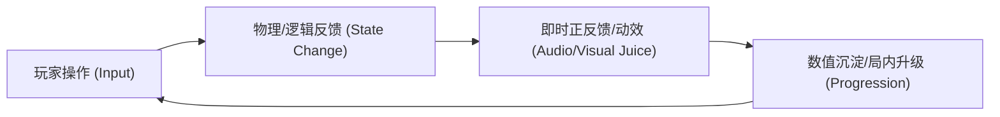

# 游戏原型需求契约 (GAME_SPEC)

> 本文档为 Antigravity 阶段一战略对齐的产物，任何游戏原型研发必须在此任务契约固化后方可启动实施。

## 1. 核心玩乐原语与痛点定义 (Core Problem & Hook)
- **目标受众与平台**：[例如：微信小游戏 / 休闲轻度玩家]
- **核心玩法爽点 (The Hook)**：[用 1 句话讲清玩家为何感到有趣，如：“通过反弹弹球击碎不断下落的方块并合成强力技能”]
- **输入方式**：[单指触摸拖拽 / 键盘 WASD / 虚拟摇杆]

## 2. 核心玩法循环 (Core Gameplay Loop)

- **微观循环 (3-10 秒)**：[操作与单次反馈，如：瞄准发射 -> 消除弹跳 -> 音效触发]
- **宏观循环 (1-3 分钟)**：[单局结算、计分与重新开始流程]

## 3. 明天可交付的最狭窄闭环切入点 (Narrowest Playable Slice)
> 严禁过早开发商业化、复杂商城、多章节关卡或成就系统。仅聚焦单一闭环：
- **包含内容**：
  1. 基础物理/移动手感验证；
  2. 1 种核心敌方/方块交互；
  3. 基础得分与死亡/重开状态流转；
  4. 核心音效与屏幕震动击打反馈。
- **验证手段**：可在浏览器中以 60 FPS 完整运行一局游戏，且能顺利重开。

## 4. 显式非目标 (Explicit Non-Goals)
- [ ] 暂不做后端网络排行榜（先做本地 localStorage 最佳记录）；
- [ ] 暂不做复杂技能树系统（固定初始属性）；
- [ ] 暂不接入商业化广告 SDK 与内购支付；
- [ ] 暂不做多语言国际化支持（硬编码中文/极简英文）。

## 5. 关键领域专有名词 (Ubiquitous Language)
| 术语 (Name) | 代码标识符 (Identifier) | 精确定义与职责 |
| :--- | :--- | :--- |
| 发射器 | `ShooterController` | 负责响应玩家触摸拖拽、计算发射角度并调度子弹 |
| 砖块实体 | `BrickEntity` | 具备耐久度值，碰撞后扣减并在耐久归零时回收进对象池 |
| 局内状态机 | `BattleFSM` | 控制 READY, AIMING, ROLLING, SETTLING, GAMEOVER 五种状态 |

## 6. 性能与平台红线指标 (Budget Thresholds)
- **帧率目标 (FPS)**：低端机稳 60 FPS，最低不低于 55 FPS。
- **DrawCall 预算**：战斗画面 <= 45；UI 界面 <= 20。
- **内存红线 (Memory)**：运行稳态内存占用 <= 350 MB，单局重开无残留泄漏。
- **对象池覆盖率**：所有发射物、击中特效、飘字 100% 纳入 `NodePool`，单局严禁动态创建销毁。

## 7. 验收测试用例 (Acceptance Test Cases)
- [ ] **用例 1（启动与输入）**：进入游戏场景，手指按住屏幕拖拽可出现平滑瞄准虚线；
- [ ] **用例 2（核心碰撞）**：发射物击中目标物体扣除耐久，耐久为 0 时目标播放碎裂动效并回池；
- [ ] **用例 3（结算闭环）**：触发失败条件时显示结算弹窗与最终得分，点击“重新开始”能秒级复原游戏且无状态遗留。
