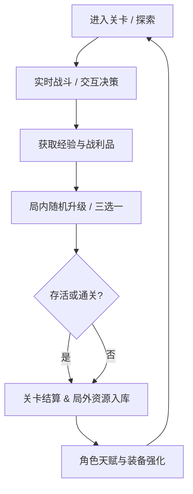

# 🎮 [游戏名称] 游戏设计说明书 (Game Design Document)

| 项目属性 | 详细规格 |
| :--- | :--- |
| **项目代号** | `[Project Codename]` |
| **目标平台** | `[微信小游戏 / Web / iOS / Android / Steam]` |
| **开发引擎** | `Cocos Creator 3.8.x (TypeScript)` |
| **画面视口** | `[750x1334 竖屏 / 1920x1080 横屏]` |
| **当前版本** | `v0.1.0 MVP` |

---

## 1. 核心概述 (Executive Summary)

### 1.1 电梯演讲 (Elevator Pitch)
一句话说明白：“这是一款在 [核心场景] 中通过 [核心机制] 带来 [核心情绪体验] 的游戏。”

### 1.2 灵感来源与竞品对照
- 参考原型：`[竞品 A]`, `[竞品 B]`
- 本作差异化切入点 (Unique Selling Point): `[1~2 个差异化设计]`

---

## 2. 核心循环 (Core Game Loop)

---

## 3. 玩法机制与控制 (Gameplay Mechanics & Controls)

### 3.1 操作映射
- **触控/摇杆**：移动与朝向控制
- **按钮/点击**：技能释放、攻击判定

### 3.2 核心数值公式骨架
- **伤害公式**：`Damage = Max(1, Attack * (100 / (100 + Defense))) * CriticalMultiplier`
- **生命值衰减与回血机制**：`...`

---

## 4. 美术与音频风格指引 (Art & Audio Direction)

- **视觉风格**：`[2D 像素 / 卡通扁平 / 暗黑手绘]`
- **色彩基调**：主色调、强调色、背景低对比度规范
- **音效清单**：UI 点击、攻击命中、受击、通关奖励、背景 BGM 列表

---

## 5. 最小可玩原型 (MVP Scope) & 显式非目标

### 5.1 MVP 交付边界 (Narrowest Wedge)
- [ ] 核心角色移动、手感与平滑碰撞
- [ ] 1 套核心技能循环与 2 种攻击反馈
- [ ] 基础怪物生成器 (Spawner) 与简易寻路 AI
- [ ] 基础结算界面与金币计数器

### 5.2 显式非目标 (Explicit Non-Goals)
- ❌ 暂不接入复杂账号鉴权与网络同步
- ❌ 暂不制作长篇剧情对话与过场 CG
- ❌ 暂不接入商业化广告与内购支付系统
