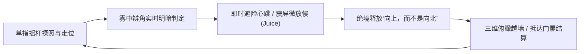

# 游戏原型需求契约 (GAME_SPEC) - 《平面国：正方形的迷雾救赎》

> 本文档为 Antigravity 阶段一战略对齐成果，严格遵循 Game-Studio 母库标准编制。

## 1. 核心玩乐原语与痛点定义 (Core Problem & Hook)
- **目标受众与平台**：微信/抖音小游戏、独立艺术解谜爱好者；竖屏 9:16（上屏 3D 全知天眼沙盘 + 下屏 2D 迷雾微观感官）。
- **核心玩法爽点 (The Hook)**：“在常年浓雾的平面国，用‘雾中辨角’在死角躲避刺客与暴民巡逻；在绝境中念出咒语‘向上，而不是向北’，触发屏幕震动与视角拉伸，以高维降维打击翻越石牢逃生！”
- **输入方式**：单指触摸拖拽虚拟摇杆控制移动与转向，右侧独立大按钮触发“向上，而不是向北 (升维跃迁)”。

## 2. 核心玩法循环 (Core Gameplay Loop)

- **微观循环 (3-10 秒)**：
  单指旋转与移动 -> 下屏迷雾光带随视线实时明暗拉伸 -> 识别逼近多边形角尖（等腰三角形的锐角暗影在雾中浮现） -> 侧向错身避险 -> 触发微小避险慢放与心跳音效。
- **宏观循环 (1-3 分钟)**：
  石牢开局（四面闭锁石室，等腰守卫巡逻） -> 收集散落的“高维神谕残页”蓄满升维能量 -> 遭遇合围死局 -> 释放“向上，而不是向北”跃入三维（震屏 + 镜头拉伸 + 跨越墙壁） -> 抵达门扉通关结算（星级与正方形手稿翻页） -> 开启下一幕。

## 3. 明天可交付的最狭窄闭环切入点 (Narrowest Playable Slice)
> 聚焦单一垂直切片关卡：**【平面国石牢脱逃记】**
- **包含内容**：
  1. **双视窗同屏联动**：下屏纯正“雾中辨角”第一人称光带 + 上屏 3D 轴测维多利亚铜版画沙盘；
  2. **1 种核心敌方交互**：等腰三角形巡逻兵（尖角穿刺具有致命碰撞，玩家需靠辨角识别其朝向并躲避）；
  3. **核心升维手感 (Juice)**：点击“向上，而不是向北”按钮，触发 0.08s 冻结帧 (Hit Stop) + 屏幕震动 (Screen Shake) + 3D 浮空跨越障碍；
  4. **胜败与结算流转**：被等腰三角形刺中碎裂死亡重开；穿过石墙抵达终点弹出评级与正方形忏悔手稿。
- **验证手段**：在浏览器或小游戏容器中以 60 FPS 完整运行一局脱逃（1~2 分钟），且能顺畅重开。

## 4. 显式非目标 (Explicit Non-Goals)
- [ ] 暂不做复杂的装备与局外繁重数值养成系统；
- [ ] 暂不做微信开放数据域多人好友排行榜（首版仅本地存储通关星级与最佳用时）；
- [ ] 暂不接入线上广告联盟 SDK（通过模拟“向球体导师祈愿”弹窗验证自愿激励视频逻辑）；
- [ ] 坚决不做多语言混排（全界面统一采用古典雅致的维多利亚清末译本文风）。

## 5. 关键领域专有名词 (Ubiquitous Language)
| 术语 (Name) | 代码标识符 (Identifier) | 精确定义与职责 |
| :--- | :--- | :--- |
| 正方形绅士 | `SquareHeroController` | 玩家操控的主角，具备 2D 移动、转向与 3D 高维升浮状态 |
| 雾中辨角渲染器 | `FogAngleRenderer` | 负责计算下屏视界光带明暗渐变（近处墨黑锐利，远处灰暗渐隐） |
| 等腰巡逻兵 | `IsoscelesPatrolAgent` | 拥有尖锐刺杀角的下层劳工/士兵，按巡逻路径行进并侦测玩家 |
| 升维状态机 | `AscensionFSM` | 管理 `PLANE_2D`（平面状态）、`ASCENDING_3D`（升维滞空）、`POINT_0D`（终局） |
| 全知神谕沙盘 | `OmniscientSandboxView` | 上屏 3D 等轴测沙盘，展示迷宫真实全局剖面与神谕透视路径 |

## 6. 性能与平台红线指标 (Budget Thresholds)
- **帧率目标 (FPS)**：iOS / Android 小游戏稳 60 FPS，最低不低于 55 FPS。
- **DrawCall 预算**：战斗总 DrawCall <= 35（依托 Auto Atlas 与 Canvas 合批）。
- **内存红线 (Memory)**：运行稳态内存 <= 300 MB，场景重开无泄漏。
- **对象池覆盖率**：巡逻兵预制体、光带扫描片、震屏特效 100% 纳入 `NodePoolManager`。

## 7. 验收测试用例 (Acceptance Test Cases)
- [ ] **用例 1（雾中辨角探照）**：玩家旋转视角时，下屏光带随与等腰兵和墙壁的距离平滑渐变，无锯齿与撕裂；
- [ ] **用例 2（等腰守卫刺杀）**：等腰三角形守卫角尖触碰正方形时触发判定，播放碎裂动效并安全重开；
- [ ] **用例 3（高维跃迁突破）**：能量满时点击“向上，而不是向北”，触发镜头拉伸与震屏，正方形升至 Z 轴穿过石墙抵达终点，弹出通关手稿。
